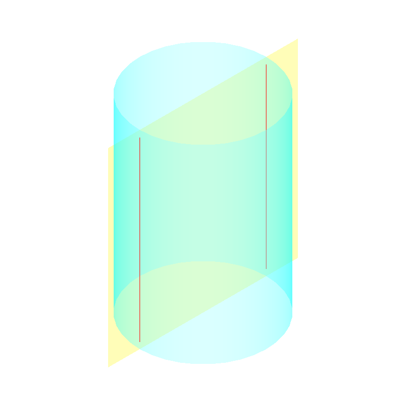

# OCCT 24313 复核与格式迁移报告

日期：2026-11-10。状态：远端已有题目，仅补充替代 Windows 环境证据。

## 问题说明

圆沿直线拉伸形成的柱面，与平面相交应有两条直线。该 issue 已在远端注册，本轮不重复出题。

[原 issue](https://occt3d.com/dev/tickets/0024313/)。仓库对照基准为 GitHub commit 7c28d6089a2389dd4788e425f773bcfadb442491。

## 实际图片

图片来自真实 OCCT DRAW 视口；不是生成的示意图。 图中只显示无界曲面的有限窗口；测试仍是无界输入。

## 本轮逐项结果

| 角色 | 案例 | 结果 |
|---|---|---|
| B | original | algorithm_exception |
| B | neighbor_shift | algorithm_exception |
| B | neighbor_radius | algorithm_exception |
| B | regression | pass |
| F | original | pass |
| F | neighbor_shift | pass |
| F | neighbor_radius | pass |
| F | regression | pass |
| negative_output_injection | original | assertion_fail |

## 验证范围

这些日志运行的是此前构造的 OCE 替代基线及对应移植参考，不是仓库现有 source_id 的正式重放。因此不改写该题已有清单、基线、suite 或历史成绩。

Windows 数值断言复跑采用相同的启动兼容设置：在 B/F 两侧都先屏蔽旧 MSVC 浮点异常陷阱，避免 Tcl 的数值解析直接导致进程退出；内核源码、几何阈值和输入不因此改变。兼容扩展的源码和 SHA-256 在批次 native-compatibility 记录中。原本的本地校准也独立重跑并保留。

负对照是作者临时测试副本中的错误几何／诊断替换，不冒充“编译 C++ 错误源码补丁”的实验。资源终止与几何断言失败分开记录。此证据没有包含 Linux build、bubblewrap 沙箱运行或付费模型实验。

## 清单与正式准入

本批目录已按 issue、group、suite、source lock 的版本化结构组织；公开题面和输入、隐藏检查、作者参考补丁及报告分开。Linux 缓存导入、构建兼容和冻结 B/F 重放未完成，新条目用 pending_requirements 阻止提前获得正式通过。23985、23998 的交线支撑／覆盖，以及 29038 的完整布尔语义也明确待补。

原始文本输出在 logs；机器记录和 native-runtime-identities.json 可用于核对本次输入判据与 DLL 身份。图文材料仅作解释，判分来自实际几何检查与资源记录。
