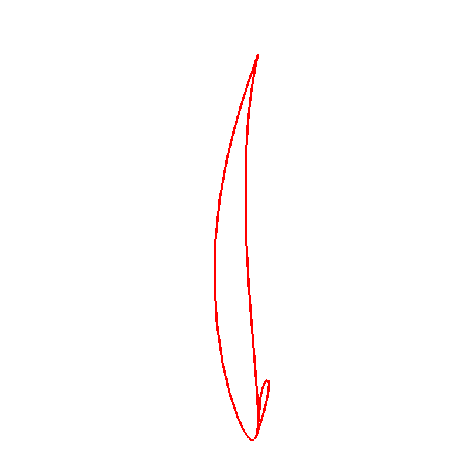
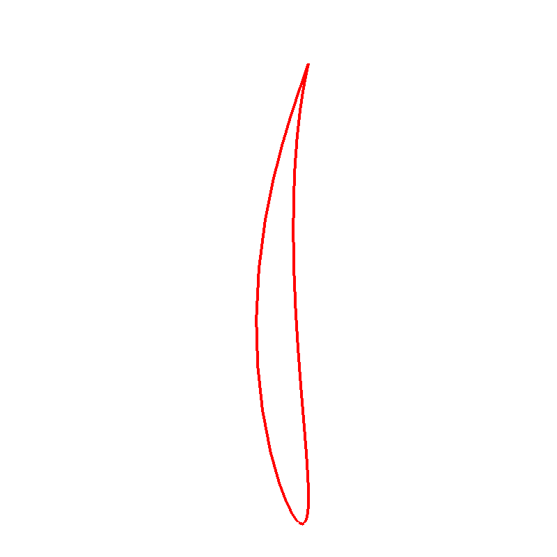

> **已被 2026-11-10 第二轮全面核查取代。** 本文及旧截图保留为历史记录，不能作为当前准入结论。请先看 [全面核查报告](../audit-v2/全面核查报告.md) 和 [当前单题核查](../audit-v2/occt-23998/review.md)。其中 29038 的“负体积来自朝向”解释已撤回；8 道题当前均未注册到默认题库。

# OCCT 23998 复核与格式迁移报告

日期：2026-11-10。状态：新增单题格式就绪，正式 Linux 准入待完成。

## 问题说明

旧版截线出现多余回环，长度约 77.8736；参考修复约 67.026。检查长度、闭合与 1001 点采样折线长度一致性；支撑曲面和覆盖仍需额外核验。

[原 issue](https://occt3d.com/dev/tickets/0023998/)。仓库对照基准为 GitHub commit 7c28d6089a2389dd4788e425f773bcfadb442491。

## 实际图片

图片来自真实 OCCT DRAW 视口；不是生成的示意图。

## 本轮逐项结果

| 角色 | 案例 | 结果 |
|---|---|---|
| B | neighbor_rotate | geometry_fail |
| B | neighbor_translate | geometry_fail |
| B | original | geometry_fail |
| B | regression | geometry_pass |
| F | neighbor_rotate | geometry_pass |
| F | neighbor_translate | geometry_pass |
| F | original | geometry_pass |
| F | regression | geometry_pass |
| negative | original | geometry_fail |

## 验证范围

本轮使用仓库标准断言接口和既有 runner/oracle，不复制每道题独立运行器。68 次格式转换后本地执行中，F 的 32 项通过，8 个结果替换负对照被拒绝。

Windows 数值断言复跑采用相同的启动兼容设置：在 B/F 两侧都先屏蔽旧 MSVC 浮点异常陷阱，避免 Tcl 的数值解析直接导致进程退出；内核源码、几何阈值和输入不因此改变。兼容扩展的源码和 SHA-256 在批次 native-compatibility 记录中。原本的本地校准也独立重跑并保留。

负对照是作者临时测试副本中的错误几何／诊断替换，不冒充“编译 C++ 错误源码补丁”的实验。资源终止与几何断言失败分开记录。此证据没有包含 Linux build、bubblewrap 沙箱运行或付费模型实验。

## 清单与正式准入

本批目录已按 issue、group、suite、source lock 的版本化结构组织；公开题面和输入、隐藏检查、作者参考补丁及报告分开。Linux 缓存导入、构建兼容和冻结 B/F 重放未完成，新条目用 pending_requirements 阻止提前获得正式通过。23985、23998 的交线支撑／覆盖，以及 29038 的完整布尔语义也明确待补。

原始文本输出在 logs；机器记录和 native-runtime-identities.json 可用于核对本次输入判据与 DLL 身份。图文材料仅作解释，判分来自实际几何检查与资源记录。
