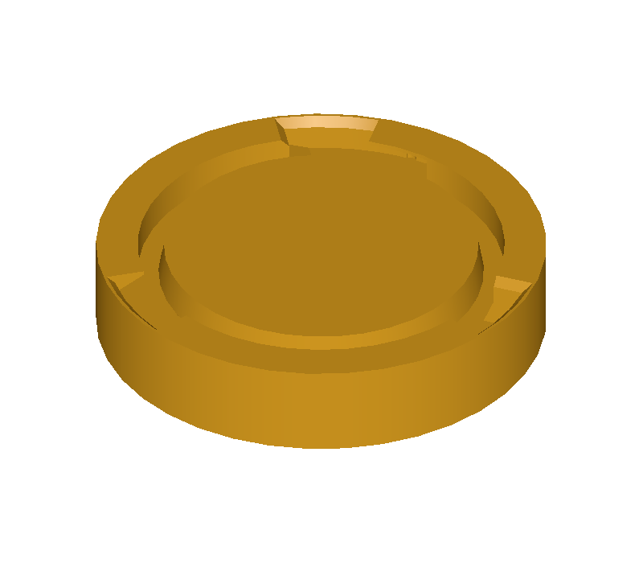
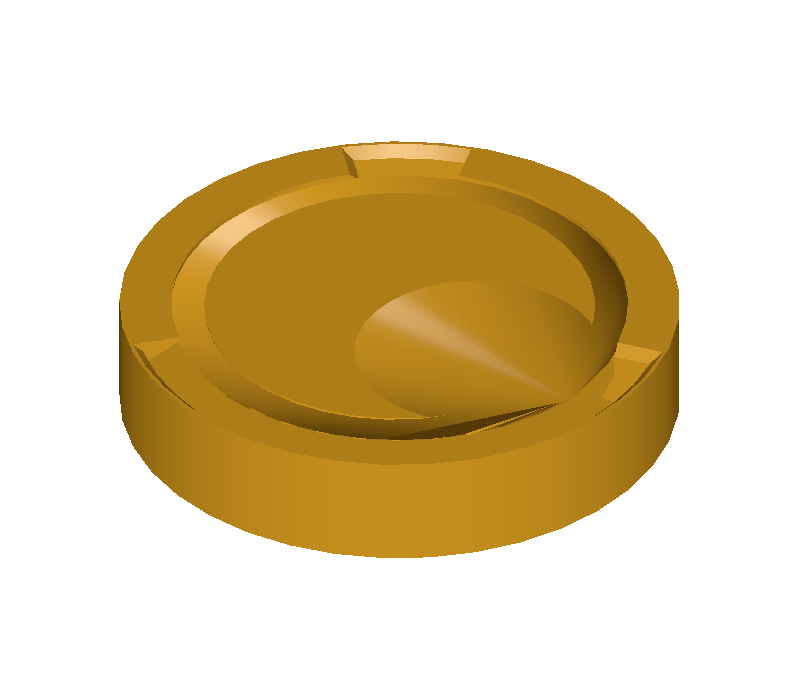

# GitHub 1163：圆角遇到空边而崩溃——本机图文验证

## 这个问题是什么意思？

把零件的一条棱加工成圆角时，内核要找出端部相邻的边并计算它们的交会关系。这个模型中的某条边没有被找到，旧逻辑却继续拿它做计算，导致整个程序崩溃。修复参考版本允许明确返回“未能完成”，避免程序退出；它不保证这个原始模型一定能加工出圆角。

上图仅展示输入形状；不能从图片本身判断是否崩溃。下面由真实进程退出状态和几何检查判断。

## 实际在这台电脑做了什么

原始 [上游 issue](https://github.com/Open-Cascade-SAS/OCCT/issues/1163) 的例子是倒角。我取出其原始模型，使用 **圆角** API 对同一模型的第 7 条边做半径 1 圆角，确认同一共享端部处理流程仍会触发问题。输入实际通过有效性检查，共有 128 条边。

参考 F 是本机官方 OCCT 8.0.1 版本；B 在相同源码上反向恢复该 issue 相关的旧空边检查方式后重新编译 `TKFillet.dll`，形成可追溯的派生基线。原始 OCCT 安装没有被覆盖；B 单独运行。完整 B/F Git 提交及哈希见 `验证证据/来源及锁定.json`，源码包在本文件夹。

| 验证 | B：旧逻辑 | F：官方新逻辑 |
|---|---|---|
| 原始模型 | 进程访问冲突退出 0xC0000005 | 程序正常结束，报告无法完成 |
| 原始模型平移 | 0xC0000005 | 程序正常结束，报告无法完成 |
| 原始模型旋转 37° | 0xC0000005 | 程序正常结束，报告无法完成 |
| 复制模型后圆角 | 成功，有效结果 47 个面 | 成功，有效结果 47 个面 |
| 普通盒子圆角 | 成功，有效结果 7 个面 | 成功，有效结果 7 个面 |

结果图片采用 OCCT 8.0.1 写出的兼容格式模型，由 7.5 DRAW 渲染。图片只是帮助观察，结果有效性和面数来自独立程序检查。所有输出记录保存在 `验证证据/Windows-*`。进程崩溃的退出码是外层调用记录的，不是由崩溃程序自行打印。

## 目前的边界

题包使用工程现有 `cpp_case_v1` 格式设计，已在 Windows 原生运行 B/F；Linux 与冻结重放结果见下文。上游 issue 原例为倒角；这里明确是基于它另行构造的圆角场景。

## 后续冻结重放

在独立本机环境加入题包所附的库白名单兼容改动后，项目验证了源码缓存与冻结快照。使用已编译的 B/F OCCT 库，在 Bubblewrap 内运行冻结的 C++ 检查点。B 的缺陷用例失败，F 全部通过。证据见 freeze.log、frozen-B.json 和 frozen-F.json。项目默认配置仍需要采纳兼容补丁。此次验证重放冻结检查点，构建在沙箱外完成。
