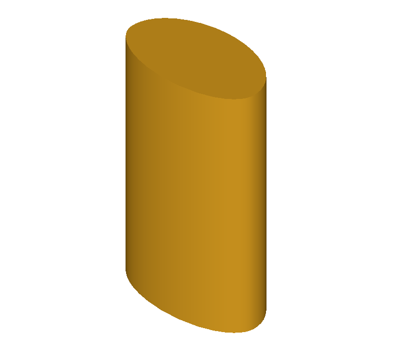
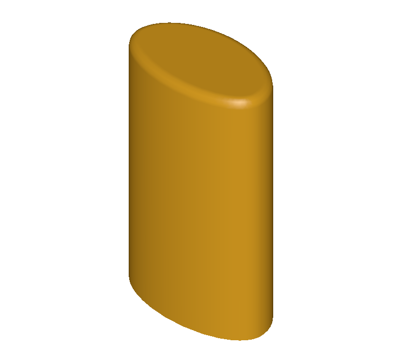

# GitHub 1371：圆角结果有自交，却被报告为成功

## 图中发生了什么

这是用闭合 B 样条曲线围出截面、再拉伸出的零件。对顶面边做圆角，OCCT 8.0.1 原版会报告成功，但结果实际有无效面、自干涉和过小边。图片帮助看形状，缺陷是否存在由下列几何检查判断，不能仅凭截图。

## 本机执行和结果

本机使用官方 OCCT 8.0.1 作为 B；上游最初报告的 8.0.0.p1 与这里不是同一版本。本机 B 对原始半径 0.35、邻近半径 0.2 和 0.1 均返回 `IsDone=true`，但 `BRepCheck_Analyzer` 报无效；`BRepAlgoAPI_Check` 报 3 处自干涉、8 条过小边和 1 处其他错误。圆形、周期化轮廓和四段曲线的控制例在这台机器均成功且通过检查。

我编写了一个 **作者参考保护补丁 F**：在成功状态发布之前检查结果，发现无效结果时报告未完成。Windows 和 Linux 本机均验证：三种半径的异常例由错误成功改为受控失败，三种正常控制仍成功且通过检查。日志在 `验证证据`；`作者安全失败参考补丁.diff` 是我写的补丁，不是官方已合并的修复。

这个补丁是安全兜底：它没有让异常模型成功得到圆角，也不能保证识别所有可能的自干涉，而且每次成功构造后增加一次有效性检查，可能增加耗时。它为题目中允许的“明确失败”提供一个本机 F，几何根因和性能仍需进一步研究。

## 题包状态

本文件夹中的 `benchmarks/occt/` 按工程的 issue、group、suite 等结构准备；完整 B/F 源码提交和本地 bundle 已保存。但现有项目 C++ 评测器允许的库名单缺少 TKFillet、TKBool，且旧工具没有识别 OCCT 8 的版本文件；已提供待审阅的项目兼容补丁和本题工具适配，下文记录使用兼容改动后的冻结检查点重放。

源码及问题来源：[上游 issue 1371](https://github.com/Open-Cascade-SAS/OCCT/issues/1371)。

## 后续冻结重放

在独立本机环境加入题包所附的库白名单兼容改动后，项目验证了源码缓存与冻结快照。使用已编译的 B/F OCCT 库，在 Bubblewrap 内运行冻结的 C++ 检查点。B 的缺陷用例失败，F 全部通过。证据见 freeze.log、frozen-B.json 和 frozen-F.json。项目默认配置仍需要采纳兼容补丁。此次验证重放冻结检查点，构建在沙箱外完成。
