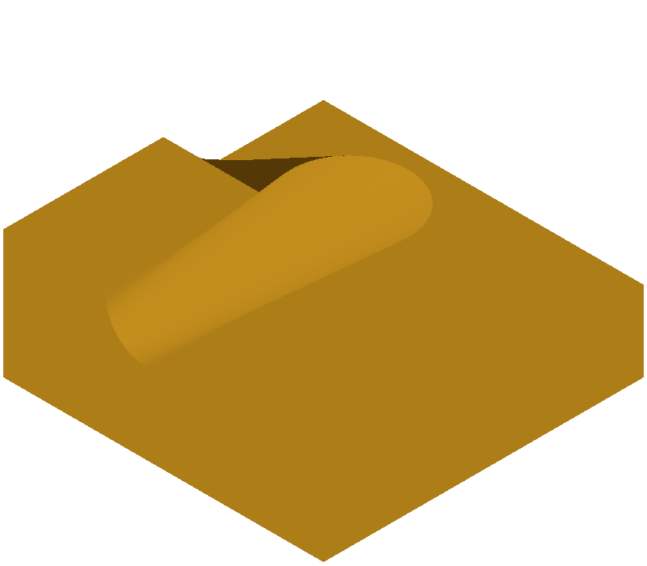
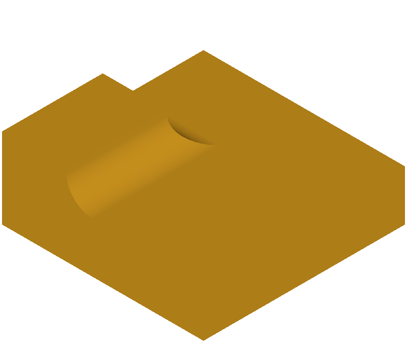

# 1701 等半径圆角导致顶点容差异常

Windows 与 Linux 的 8.0.1 基线都返回完成，最大顶点容差约 4.827。Windows 以报告给定的盒子做切割，切除体积约 194.619，结果无效。半径 1.299 和 1.301 的对照切除体积约 100，结果有效。

本地参考补丁在返回成功前检查边端点的容差范围。当两端点容差之和达到端点间距时，返回未完成。Windows、Linux 和冻结检查中，等半径用例受控失败，两个邻近半径仍成功。F 通过 3/3。此补丁符合原报告允许的失败路径。它没有修复相切处的几何构造，并可能拒绝其他容差重叠的边，适用范围仍需扩大验证。

