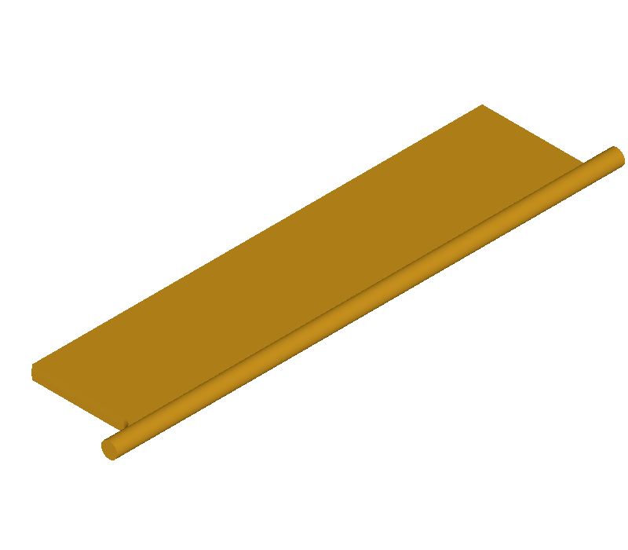

# 1702 双边圆角返回无效线框

在杆半径 1.6 的模型上同时对第 11、21 条边做半径 1.3 圆角，原版报告完成，BRep 有效性检查失败。本机复现程序另得到 5 条布尔诊断。参考实现复用 1371 的有效性检查保护，异常结果返回未完成，单直边、单弧边和杆半径 1.5 的双边对照仍成功且有效。Windows 和 Linux 结果一致，冻结检查 F 通过 4/4。此补丁防止发布无效结果，几何自交根因尚未修复。

